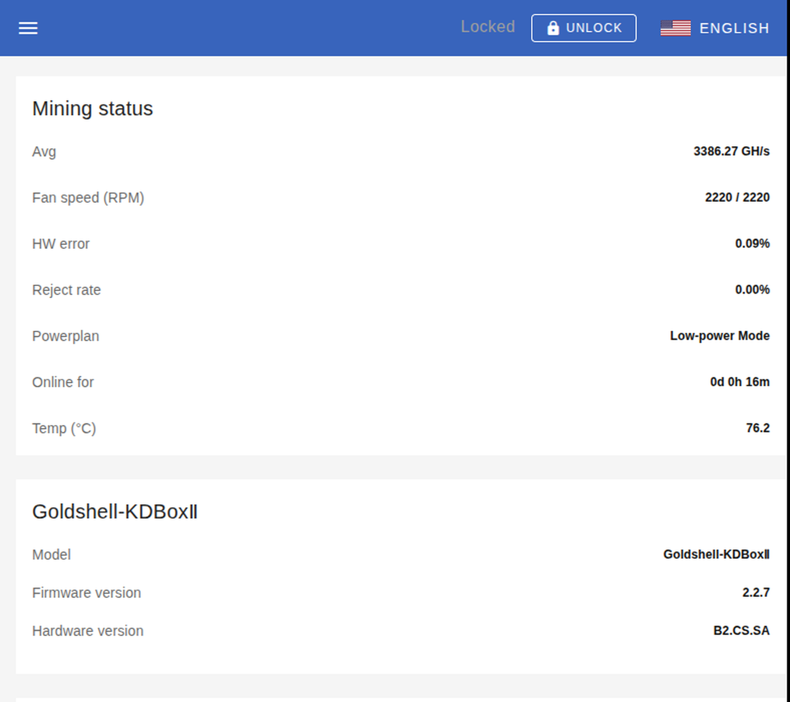
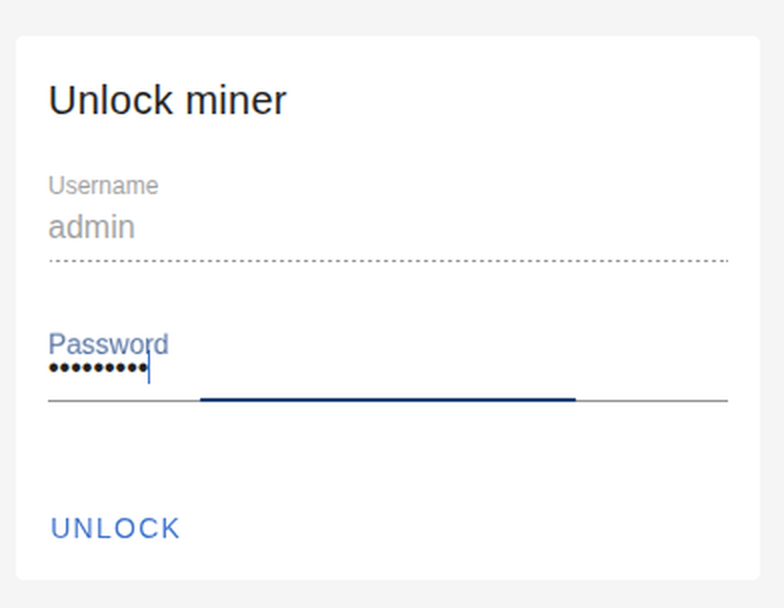
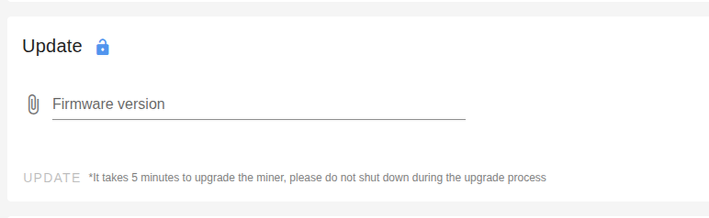

# Flashing from the web GUI

Same package, same endpoint, no shell needed — just a browser on the same LAN as the miner.
Everything below was captured on a KD Box II running the custom image (`10.0.0.10`,
firmware 2.2.7, MCB `MCB_V6_3_5`).

Use this when you don't want to hand a miner's IP to a script, or you're on a machine that
doesn't have the repo checked out. Use `tools/flash.sh` when you're flashing several units or
want a record of what you sent.

---

## Before you start

- The `.cpb` must be **on the machine running the browser** — the GUI uploads it from disk,
  it can't pull it off another host.
- The miner must answer `http://<miner-ip>/`.
- You need the **admin password**. Factory default is `123456789`; if you've changed it,
  use the new one.
- **The package's contents are version-bound, not its filename.** Check the target's
  `mcbversion` first (dashboard → *Hardware version* is the only version info shown there;
  `curl http://<ip>/mcb/status` gives you `mcbversion`). If the unit isn't
  `MCB_V6_3_5`, rebuild from *its* stock package instead of reusing ours — see
  [PROCEDURE.md §11](PROCEDURE.md).

---

## Step 1 — open the miner

Browse to `http://<miner-ip>/`. No login is required to look around; the dashboard is
read-only.



Confirm **Firmware version** and **Hardware version** here. The header shows `Locked` and an
`UNLOCK` button — that's the settings lock, not a broken session.

## Step 2 — go to System

Hamburger menu (top left) → **System**. The URL becomes `/#/system`.

You can go straight there: `http://<miner-ip>/#/system`.

## Step 3 — unlock the settings

Click **UNLOCK** in the header. The *Unlock miner* card appears:



- **Username** is fixed to `admin` (greyed out — you can't change it here).
- **Password** is the admin password, `123456789` on a factory unit.

Click **UNLOCK**. The header flips to a green `Unlocked` with a `LOCK` button, and the
`APPLY` / `CHANGE` / `UPDATE` buttons in the cards below become active.

> Unlocking stores a JWT in the browser. Reloading the page keeps it; closing the browser
> doesn't. Nothing about it is needed for the miner to run.

## Step 4 — find the Update card

Scroll to **Update**. It sits between *Change password* and *Reset*.

Locked (no session, nothing selected):


Unlocked, still nothing chosen — `UPDATE` stays greyed out until a file is picked:



## Step 5 — choose the package

Click the **Firmware version** field (the paperclip icon) and pick your `.cpb`. The file
chooser filters to `.tgz,.cpb`, which is the only two formats this firmware accepts — the
stock Goldshell packages are `.cpb`, so ours is too.


The field shows the name and size, and `UPDATE` turns blue. Sanity-check the size before
clicking: the custom 2.2.7 package is **40,805,376 B (40.8 MB)**. If you see
`41,268,224 B`, you've picked the **stock** rollback package by mistake — see the gotchas.

## Step 6 — click UPDATE

**There is no confirmation dialog.** The click starts the upload immediately and the miner
starts its update as soon as the signature verifies.

The card shows a progress bar and a status line that walks through three stages — these are
the UI's own strings:

| stage | message |
|---|---|
| upload | `Uploading firmware to miner...` |
| verify | `Firmware is being verified by miner...` |
| flash | `Miner is in updating progress...` |

then, on reconnect, `Miner firmware is updated to <version>` / `Update Finish`.

The UI also warns, under the button: *"It takes 5 minutes to upgrade the miner, please do
not shut down during the upgrade process"*. Measured on hardware it's closer to **3.5
minutes** from the click: upload ~7 s, services die, ~2.5 min offline, back up.

> The progress/finish states above are the strings from the app bundle (`chunk_setting-system`
> → `SYSTEM_FIRMWARE_*`), not screenshots — capturing them for real means actually flashing,
> which is the one step this document deliberately stops short of.

### What you'll see that looks wrong but isn't

- **The page stops responding partway through.** Expected: the daemon kills userspace and
  the box drops off the network mid-flash.
- **`Update process terminated. Please choose the officially issued update package.`**
  (`SYSTEM_FILE_TRANSFER_ERROR`) — the UI says this when the connection dies under it. On a
  real update the box is already flashing at that point. **Don't re-upload.** Wait ~4
  minutes, reload `http://<miner-ip>/`, and look at *Firmware version*.
- **Your browser tab can be closed.** The update runs on the miner, not in the page.

## Step 7 — verify

After the box comes back:

1. Reload the dashboard — *Firmware version* should read `2.2.7`, and the miner should be
   hashing again (the config partition is rewritten by the flash, so **pools are gone** —
   re-add them in the GUI under *Miner*, or via `PUT /mcb/newpool`).
2. Confirm root:

   ```sh
   ssh -i ~/.ssh/kdbox_rsa \
       -o PubkeyAcceptedKeyTypes=+ssh-rsa -o HostKeyAlgorithms=+ssh-rsa \
       root@<miner-ip> 'id; cat /etc/kdbox-custom-fw'
   ```

   Expect `uid=0(root)` and the marker line.

If the dashboard still shows the old firmware and the miner is mining, the package was
rejected without being written — nothing was damaged, but nothing changed either.

---

## Rolling back from the GUI

Identical procedure with the **stock** package from
<https://github.com/goldshellminer/firmware>: System → unlock → Update → choose the stock
`.cpb` → UPDATE. Same ~3.5 minutes.

You lose root SSH when you do that (the stock rootfs has our key removed and sshd killed at
boot). You keep the box.

---

## Gotchas

- **No confirmation step.** `UPDATE` is a live-fire button. The click *is* the confirmation.
- **The file chooser remembers.** It opens on Recent files, and if you hit Enter without a
  fully-typed path you can silently attach whatever was selected — including the 41.3 MB
  *stock* package sitting next to ours. Watch the name/size in the field, not the dialog.
- **Filename doesn't matter, contents do.** The GUI uploads whatever name you picked; the
  daemon copies it to `firmware-<mcbversion>.tgz` itself before verifying. Renaming a
  package from another model doesn't change the image inside it — that's the one way to
  need a serial cable.
- **A locked UI can still browse.** `UNLOCK` only gates the write operations; every value on
  the dashboard is readable without credentials, and `/mcb/wifisetting` hands out the WiFi
  PSK with no auth at all. Don't expose port 80 of the miner beyond your LAN.
- **Change the admin password** (*Change password* card, right above Update) — it's
  `123456789` in plaintext in `/mnt/config/minerd/settings/login.json` until you do.

---

## What the GUI is actually doing

`chunk_setting-system` builds a `FormData`, appends the file under the field name `file`,
and POSTs it to `/mcb/uploadimage` with the JWT from the unlock step in an
`Authorization: Bearer` header. That is byte-for-byte what `tools/flash.sh` does — the GUI
gives you no extra privileges and hits exactly the same verification path described in
[FINDINGS.md §3](FINDINGS.md).

Which is also why the browser tooling can't shortcut the 40 MB upload: the only privileged
step is an ordinary authenticated multipart POST.
